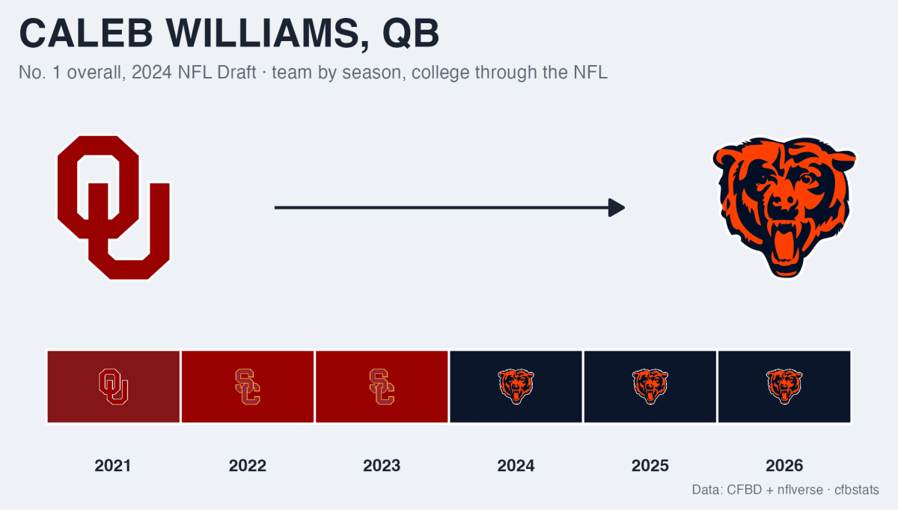

**CFB2NFL**

*What makes a college football player go pro?*

This project asks what does the data say about the path from college football to the NFL Draft:
when it happens, when it doesn't, and what it takes to get there.

[About](vignettes/about.qmd) · [Explorer](vignettes/explorer.qmd) · [Investigations](vignettes/investigations.qmd)

> [!WARNING]
> **Work in progress.** Data, code, methods, and explorations change often and
> without notice. Nothing here is stable or final.

## Why

Plenty of people are invested in this game, but none more than the players:
for the few who are drafted, it means being on the world stage and building a career 
that can yield life changing outcomes for their family and community.

## What you'll find

- **[Explorer](vignettes/explorer.qmd)**: interactive charts of teams,
  conferences, players, and the draft. A place to generate your own hypotheses.
- **[Investigations](vignettes/investigations.qmd)**: quick looks into aspects
  of the data. Never conclusive. 
- **[About](vignettes/about.qmd)**: why we're doing this, how AI fits in, and
  where it's headed.

## How

- **Data pipeline** organize the data so it can support analyses and models later.
- **AI inside guardrails:** agents do the legwork, while tests, data checks,
  and a written decision log keep the answers honest.
- **Test claims later:** curated analyses asking whether the data supports,
  refutes, or can't speak to common football wisdom.

## Data

[College Football Data](https://collegefootballdata.com) (draft picks, stats,
rosters, recruiting, coaches, games, play-by-play) and
[nflverse](https://nflverse.nflreadr.com/) (NFL careers and the Combine).
Under the hood: [Data](vignettes/data.qmd) · [Pipeline](vignettes/pipeline.qmd)
· [VISION.md](VISION.md).
